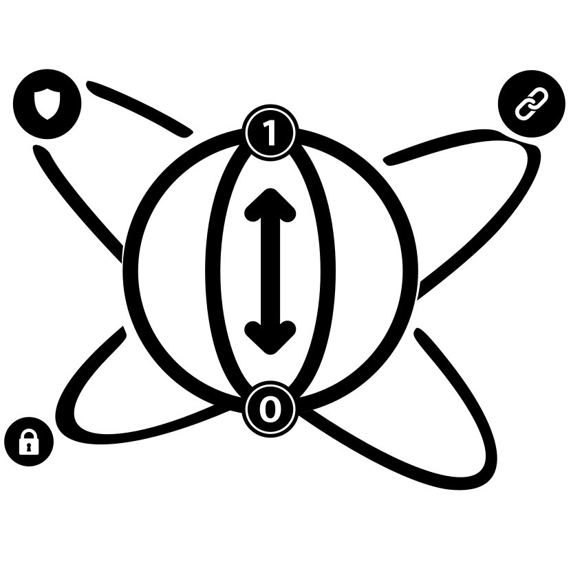

<p align="center">
  
</p>

<h1 align="center">qchain-network</h1>

<p align="center">
  <b>QChain's Hyperledger Fabric network, with a post-quantum Membership Service Provider.</b><br/>
  Every Fabric identity uses ML-DSA-44: the orderer, the peers, the admins and the application users, and the peer and orderer TLS certificates too. Pure post-quantum, not hybrid.
</p>

<p align="center">
  
  
  
  
  
</p>

---

## 🌐 Live network

The network runs on our university VM and has been live since **7 November 2026**, when it replaced the classical
(ECDSA) network. It is not exposed to the internet: every port listens on 127.0.0.1, and the outside world reaches
the ledger only through the QChain API ([qchain-backend](https://github.com/teamqchain/qchain-backend)).

> ⚠️ **It's a demo network.** Two organisations, one orderer and two peers on one machine, with test passwords.
> See [Known limits](#known-limits).

The classical version is kept in this repository's history under the tag `classical-network-final`.
[CHANGES-PQC.md](CHANGES-PQC.md) lists every difference from it and the reason for each.

---

## Overview

**QChain** is a post-quantum credential system. Credentials are signed with **ML-DSA-44** and anchored on this
permissioned **Hyperledger Fabric** network. The ledger holds a small signed record per credential (metadata, the IPFS
CID and salted SHA3-256 field fingerprints), never the credential's contents.

The network has two member organisations:

| Organisation | MSP | Role | Peer |
|--------------|-----|------|------|
| University of Sharjah | `GeneralMSP` | the issuer: its application identities `issuer1` and `verifier1` sign the transactions | `peer0.general.uae.com:29051` |
| Government | `GovernmentMSP` | the second endorsing organisation | `peer0.government.uae.com:27051` |
| Orderer organisation | `OrdererMSP` | runs the etcdraft ordering service | `orderer0.orderer.example.com:27050` |

Channel **`mychannel`**, chaincode **`qchaincode`** (JavaScript, Fabric Contract API 2.5), version 2.0, sequence 1, run as
a service. State database: goleveldb (no CouchDB).

---

## Architecture

```
                          QChain API  (qchain-backend, :3000)
                     Fabric Gateway · ML-DSA-44 identity from wallet/
                                       │  gRPC + TLS (ML-DSA-44 certificates)
             ┌─────────────────────────┴──────────────────────────┐
             ▼                                                    ▼
   peer0.general.uae.com :29051                    peer0.government.uae.com :27051
   GeneralMSP · goleveldb · ledger copy            GovernmentMSP · goleveldb · ledger copy
             │                                                    │
             └──────────────┬─────────────── chaincode as a service ─────┐
                            ▼                                            ▼
            orderer0.orderer.example.com :27050            chaincode-qchaincode :9998
            etcdraft · blocks to both peers                image qchain-pqc/ccaas-qchain:2.0

   ca.general :28054  ·  ca.government :27054     (PQC Fabric CA: issues ML-DSA-44 user certificates)
```

- **Endorsement:** the channel default, `MAJORITY Endorsement`. With two organisations, every write needs both peers.
- **Containers:** Docker Compose project `qchainpqc`; every container, volume and network is named `qchainpqc_*`, and
  the ledgers live in named volumes, independent of this folder.

---

## Post-quantum coverage

### How the post-quantum MSP works

- **Crypto provider:** `config/core.yaml` and `config/orderer.yaml` set the BCCSP to `Default: PQC`, the ML-DSA-44
  provider in the PQC builds of Fabric. Each node reads its key from a `pqc-keystore` folder.
- **Nodes and admins:** `cryptogen` generates ML-DSA-44 keys and certificates, including TLS, from
  `config/crypto-config.yaml` (`PublicKeyAlgorithm: mldsa44`).
- **Application users:** each organisation's Fabric CA issues ML-DSA-44 certificates. It uses the `cryptogen`
  organisation CA certificate and key, so its users chain to the channel's MSP root. `issuer1` and `verifier1` carry a
  `role` attribute in their certificates, which the chaincode checks.
- **Channel:** capability `V3_0`, which ML-DSA identities need.
- **Wallets:** `mkwallet-g1` (built from `cmd/mkwallet` in qchain-backend) writes each `.id` file with the certificate
  and the PKCS#8 ML-DSA-44 private key.
- **Backend:** qchain-backend signs Fabric Gateway transactions with Go 1.27's `crypto/mldsa` (`ledger/fabric.go`).
- **Chaincode:** run as a service, because the peers no longer build chaincode through Docker.

### Verified on the live network (7 November 2026)

- All 58 certificates in `crypto-material` carry the ML-DSA-44 OID `2.16.840.1.101.3.4.3.17`, and so do the
  certificates of `issuer1`, both peers and the orderer in the newest block.
- The end-to-end API test passes 123/123. The chain, MySQL and IPFS match record by record.
- The issuer signature stored on the chain is 2420 bytes, the size of an ML-DSA-44 signature.
- After a Docker restart, all containers come back with their data intact.

To check the identities yourself, from this repository's root (older OpenSSL prints the OID, newer versions print
ML-DSA-44, and nothing else should appear):

```bash
find crypto-material -path '*/signcerts/*.pem' -exec openssl x509 -in {} -noout -text \; | grep 'Public Key Algorithm' | sort | uniq -c
```

### How it differs from the classical network

| | Classical network | This network |
|---|---|---|
| Signature algorithm | ECDSA P-256 (SW BCCSP) | ML-DSA-44 (BCCSP `PQC`) |
| Images | `hyperledger/fabric-*` | `qchain-pqc/orderer:e472b4ea`, `qchain-pqc/peer:e472b4ea`, `qchain-pqc/fabric-ca-server:e82caf43`, `qchain-pqc/ccaas-qchain:2.0`, `qchain-pqc/tools:20261105` |
| Node and admin crypto | Fabric CA enrolment | PQC `cryptogen` (`config/crypto-config.yaml`) |
| Application identities | Fabric CA (Node SDK or CLI) | PQC Fabric CA per organisation, chaining to the channel MSP root |
| CA server TLS | Generated by the CA | External ECDSA P-256 certificate per CA, because a PQC CA refuses TLS without a key file |
| CAs | government, general, orderer | government, general |
| Channel | `mychannel`, Channel V2_0 | `mychannel`, Channel V3_0, Orderer V2_0, Application V2_5 |
| Chaincode | Node chaincode built through `docker.sock` | Chaincode as a service, `qchaincode` 2.0, no `docker.sock` |
| State database | CouchDB | goleveldb, no CouchDB |
| Wallets | `sed` over `keystore/*_sk` | `mkwallet-g1` |
| Compose | project `docker`, unprefixed names | project `qchainpqc`, everything named `qchainpqc_*` |
| After a restart | `qchain-fabric.service` systemd unit | Docker restart policy `unless-stopped` |

---

## Technology stack

| Layer | Technology |
|-------|------------|
| Blockchain | Hyperledger Fabric, PQC builds (Fabric `e472b4ea`, Fabric CA `e82caf43`) with an ML-DSA-44 MSP |
| Consensus | etcdraft, one orderer node |
| State database | goleveldb |
| Chaincode | JavaScript, Fabric Contract API 2.5, chaincode as a service (`chaincode/`) |
| Tooling | `peer`, `osnadmin`, `fabric-ca-client`, `cryptogen`, `configtxgen`, `mkwallet-g1`, all run from the `qchain-pqc/tools` image |
| Orchestration | Docker Compose (`docker/`) |

### Ports (127.0.0.1 only; container port = host port)

| Service | Port | Operations (internal, not published) |
|---|---|---|
| orderer0 | 27050, admin 27053 | 38443 |
| peer0.government | 27051 (chaincode 27052, internal) | 39444 |
| peer0.general | 29051 (chaincode 29052, internal) | 39445 |
| ca.government | 27054 | 37054 |
| ca.general | 28054 | 38054 |
| chaincode-qchaincode | 9998 (internal) | |
| ipfs (optional profile; QChain normally uses a systemd IPFS daemon) | 24001, 25001, 28080 | |

---

## Repository structure

```
qchain-network/
├── chaincode/              # QChaincode.js (v2.0), index.js, package.json, test/ (node:test suite)
├── config/                 # configtx.yaml, core.yaml, crypto-config.yaml, orderer.yaml
├── connection/             # connection-*.example.json (copy to connection-*.json and fill in)
├── docker/                 # docker-compose.yaml (orderer, peers, chaincode, optional ipfs) + docker-compose-ca.yaml
├── fabric-ca/              # CA server configs (general, government); everything else there is runtime
├── channel-artifacts/      # channel block (runtime)
├── scripts/
│   ├── pqc-env.sh qchain-pqc-cli.sh       # shared settings; CLI wrappers around the tools image
│   ├── generate-crypto-pqc.sh             # ML-DSA-44 crypto material, CA files, CA server TLS
│   ├── start-fabric-network.sh stop-fabric-network.sh teardown-pqc.sh
│   ├── create-channel-pqc.sh deployCC-pqc.sh
│   ├── registerEnroll.sh registerUser-pqc.sh   # CA admins, users, wallets
│   └── env-gov.sh env-gen.sh              # peer CLI environment per organisation
├── CHANGES-PQC.md          # every change from the classical network, with the reason
└── LICENSE
```

**Runtime files** are generated on the machine and ignored by Git. They hold private keys, so never commit them or
copy them anywhere else: `crypto-material/`, `wallet/`, `chaincode-pkg/`, `channel-artifacts/*.block`, and everything
in `fabric-ca/<org>/` except `fabric-ca-server-config.yaml`. `generate-crypto-pqc.sh` writes this folder's absolute
path into the CLI and CA client configs, so moving the folder means updating those files.

---

## Getting started

### Prerequisites

1. **Docker with Compose.** The scripts only touch objects named `qchainpqc_*`. Don't use `docker system prune`,
   `docker volume prune` or `--remove-orphans` on this project.
2. **The five `qchain-pqc/*` images**, loaded locally (`docker images 'qchain-pqc/*'`). They are built for x86_64 from the
   team's Fabric (`e472b4ea`) and Fabric CA (`e82caf43`) forks. Stock `hyperledger/*` images can't run ML-DSA identities.
   `qchain-pqc/ccaas-qchain:2.0` contains the code in `chaincode/`.
3. **The CLI wrappers**, once per machine:
   ```bash
   bash scripts/qchain-pqc-cli.sh install ~/pqc-tools/bin
   ```
   This creates `peer`, `osnadmin`, `fabric-ca-client`, `cryptogen`, `configtxgen` and `mkwallet-g1` as symlinks that
   run each tool from the `qchain-pqc/tools` image. `scripts/pqc-env.sh` looks in this folder by default.
4. **`/etc/hosts` entries** mapping `orderer0.orderer.example.com`, `peer0.government.uae.com` and
   `peer0.general.uae.com` to 127.0.0.1. The CAs are reached at `https://localhost:<port>`.
5. **`openssl`** at `/usr/bin/openssl`, for the CA server TLS certificates and random user secrets.

### 1. Clone

Clone it next to qchain-backend, which reads this folder's wallets and certificates:

```bash
mkdir -p ~/teamqchain && cd ~/teamqchain
git clone https://github.com/teamqchain/qchain-network.git
cd qchain-network
```

### 2. First build

```bash
bash scripts/generate-crypto-pqc.sh     # 1. ML-DSA-44 crypto material, CA files, ECDSA CA server TLS
bash scripts/start-fabric-network.sh    # 2. CAs, orderer, peers
sleep 10
bash scripts/create-channel-pqc.sh      # 3. channel mychannel: genesis, orderer join, peer joins
bash scripts/registerEnroll.sh          # 4. CA admins, issuer1 and verifier1 at GeneralCA, wallets
bash scripts/deployCC-pqc.sh            # 5. chaincode qchaincode 2.0 as a service
```

More users:

```bash
bash scripts/registerUser-pqc.sh Ahmed AlMansouri General issuer
```

### Peer CLI

```bash
. scripts/env-gov.sh    # or env-gen.sh
"$PEER" chaincode query -C mychannel -n qchaincode -c '{"function":"getHolder","Args":["<id>"]}'
```

### Stop and remove

```bash
bash scripts/stop-fabric-network.sh     # stop; containers, ledgers and keys stay
bash scripts/teardown-pqc.sh            # list what would be removed
bash scripts/teardown-pqc.sh --yes      # remove qchainpqc_* containers, volumes and network; keys stay

# Key deletion is a separate action. It refuses while any qchainpqc_ container exists.
bash scripts/teardown-pqc.sh purge-crypto                    # list
bash scripts/teardown-pqc.sh purge-crypto --yes-delete-keys  # delete crypto-material/, wallet/, CA runtime files
```

### Clean ledger reset

This empties the ledger and keeps the keys, wallets and CA data. It takes about 30 seconds.

```bash
docker stop -t 20 qchain-api
bash scripts/teardown-pqc.sh --yes
rm -f channel-artifacts/mychannel.block
rm -rf chaincode-pkg
bash scripts/start-fabric-network.sh
sleep 10
bash scripts/create-channel-pqc.sh
bash scripts/deployCC-pqc.sh
```

Then clear the chain-linked MySQL tables and all IPFS pins, and only then start the backend again.

> ⚠️ **The ledger and MySQL must be cleared together.** The backend seeds its holder ID counter from MySQL, so clearing
> MySQL alone makes new IDs collide with holders still on the chain (`Holder already registered`).

### Backend settings

qchain-backend's `docker/docker-run.sh` mounts this folder read-only at `/qchain-network`, and reads
`crypto-material/peerOrganizations/<org>/peers/<peer>/tls/ca.crt` and `wallet/<org>/<id>.id` from it. The backend's
defaults match this network; its `.env` only needs these if they change:

```
GOV_PEER_ENDPOINT=peer0.government.uae.com:27051
GEN_PEER_ENDPOINT=peer0.general.uae.com:29051
ISSUER_IDENTITY=issuer1
VERIFIER_IDENTITY=verifier1
CHANNEL_NAME=mychannel
CHAINCODE_NAME=qchaincode
```

### Chaincode tests

```bash
cd chaincode && npm install && node --test
```

---

## Known limits

- **ML-DSA-44 only.** No other ML-DSA levels.
- **The CA server TLS is classical** (ECDSA P-256 certificate). With OpenSSL 3.5 clients, TLS 1.3 negotiated the hybrid
  X25519MLKEM768 key exchange; the certificate signature remains ECDSA.
- **Peer and orderer TLS:** the certificates are ML-DSA-44, but the key exchange has not been checked.
- **Each CA reuses the `cryptogen` organisation CA key**, so that key exists both in `crypto-material/` and in
  `fabric-ca/<org>/cafiles/`. A pure Fabric CA flow with fresh CA roots has not been tried.
- **Remaining ECDSA paths in Fabric** (not used here): tlsgen, the discover CLI, SmartBFT/cluster.
- **Certificates carry `cryptogen`'s default location** (US, California, San Francisco).
- **Test credentials:** the CA bootstrap password `adminpw` and the issuer1/verifier1 secrets are test defaults. The CAs
  listen on 127.0.0.1 only. Don't reuse these values anywhere real.
- **TLS verification off:** `httpOptions.verify:false` in the connection examples disables CA TLS verification for SDK
  clients.
- **One machine:** a single orderer and two peers on loopback, and one machine generates every organisation's keys.

---

## Roadmap

In a production consortium, every member organisation runs its own peers and CA on its own servers and keeps its own
keys. Moving this network there needs:

- **A per-organisation setup:** each organisation generates its own keys with its own CA, on its own server; private keys
  never leave it. Today one machine generates all of them.
- **Adding an organisation:** a new university becomes a new organisation (its own MSP, CA and peers), admitted by a
  channel configuration update signed by the existing members (`MAJORITY Admins`), then joins its peer to the channel
  and installs and approves the chaincode.
- **Availability:** a Raft cluster of 3 or 5 orderers spread across organisations, and an endorsement policy that keeps
  writes going when one organisation's peer is down.
- **Networking:** reachable peer and orderer endpoints between organisations, with anchor peers and matching TLS host
  names.
- **Images:** the PQC Fabric images published to a registry (or built from the team's Fabric and Fabric CA repositories),
  so another organisation can run them.
- **Issuer signing on the university's side,** so a shared backend never holds a university's signing key.

---

## Documentation

- [CHANGES-PQC.md](CHANGES-PQC.md): every change from the classical network, with the reason
- [Setup guide](https://github.com/teamqchain/qchain-docs/blob/main/docs/setup.md): the whole system from scratch, including this network (section 6)
- [qchain-backend](https://github.com/teamqchain/qchain-backend): the API that reads this network's wallets and certificates, and the database schema

---

## Related repositories

| Repository | What it holds |
|------------|---------------|
| [qchain-portal](https://github.com/teamqchain/qchain-portal) | QPortal, the web portal for issuers, verifiers and IT admins |
| [qchain-wallet](https://github.com/teamqchain/qchain-wallet) | QWallet, the holder's mobile app |
| [qchain-shared](https://github.com/teamqchain/qchain-shared) | the shared Flutter package: certificate template and viewer |
| [qchain-backend](https://github.com/teamqchain/qchain-backend) | the Go REST API, MySQL schema, gateway, CI/CD and end-to-end tests |
| [qchain-network](https://github.com/teamqchain/qchain-network) | this repository |
| [qchain-docs](https://github.com/teamqchain/qchain-docs) | reports, the setup guide and the preliminary benchmarks |
| [qchain-kpi](https://github.com/teamqchain/qchain-kpi) | the post-quantum performance benchmarks |
| [teamqchain.github.io](https://github.com/teamqchain/teamqchain.github.io) | the project website |

Some of these repositories are private.

---

## Team

A University of Sharjah capstone project, supervised by **Dr. Manar Abu Talib** and **Dr. Sohail Abbas**.

| Member | Role |
|--------|------|
| Mohammed Bin Ali Maqqavi ([@M0hd-Maqqavi](https://github.com/M0hd-Maqqavi)) | Project Manager |
| Mohammed Abdul Haris ([@mohammed-ah-14](https://github.com/mohammed-ah-14)) | Technical Lead |
| Mohammed Nihal ([@nihvp](https://github.com/nihvp)) | Quality Assurance Lead |
| Mohammed Obeid ([@MohammedObeid88](https://github.com/MohammedObeid88)) | Blockchain Specialist |

---

## License

**Proprietary — all rights reserved.** © 2026 QChain. This source code is proprietary and confidential;
unauthorized copying, modification, distribution, or use is prohibited without prior written permission.
See [LICENSE](LICENSE).

---

## Disclaimer

This is an academic research project, not a production network. It runs on one machine with test credentials, and the
limits above apply. Never commit the runtime files: they hold every organisation's private keys.
